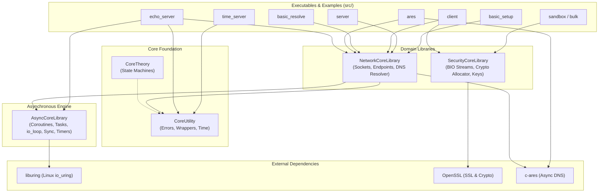
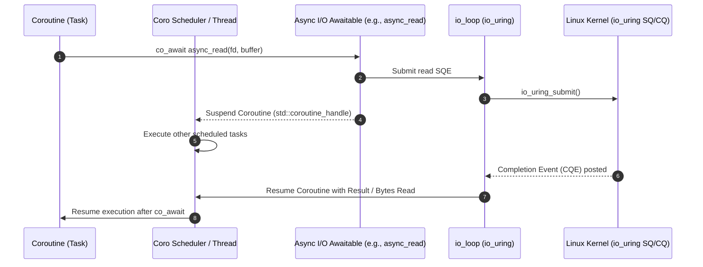
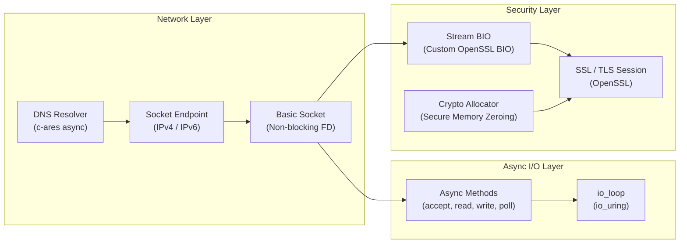

# Architecture Overview

This document provides a comprehensive overview of the `net-ut` repository architecture, component hierarchy, dependency relationships, and runtime execution models.

---

## 1. System Overview & Technology Stack

`net-ut` is a high-performance C++23 asynchronous networking and systems programming framework built around C++20/23 coroutines, Linux `io_uring`, asynchronous DNS resolution, and OpenSSL cryptography.

### Key Technical Specifications:
- **C++ Standard**: C++23 (`CMAKE_CXX_STANDARD 23`, `CMAKE_CXX_STANDARD_REQUIRED ON`) using C++20 Modules (`.cppm`)
- **Asynchronous I/O Engine**: Linux `io_uring` via `liburing`
- **DNS Resolution**: `c-ares` (v1.30.0 via `FetchContent`)
- **Security & TLS**: OpenSSL (`OpenSSL::SSL`, `OpenSSL::Crypto`)
- **Build System**: CMake (>= 3.28 with C++20 Modules support)

---

## 2. Directory & Module Structure

### Root Structure
```
net-ut/
├── AsyncCoreLibrary/       # Coroutines, io_uring scheduler, execution primitives, sync, timers
├── NetworkCoreLibrary/     # Sockets, endpoints, network adapters, async DNS resolver
├── SecurityCoreLibrary/    # OpenSSL BIO streams, crypto allocators, key parsers
├── CoreUtility/            # Shared error types, time utilities, wrappers
├── CoreTheory/             # Theoretical models, state machine implementations
├── src/                    # Application entry points, examples, and servers
├── commands/               # OpenSSL CLI scripts and cryptographic test artifacts
└── ARCHITECTURE.md         # Architecture documentation
```

---

### Module Details

#### `AsyncCoreLibrary/`
Core asynchronous runtime powered by C++ coroutines and Linux `io_uring`:
- **`core_async.cppm`**: Root module export for the asynchronous core.
- **`coro_loop/`**:
  - `i_coro_scheduler.cppm`: Abstract coroutine scheduler interface.
  - `coro_scheduler.cppm`: Concrete scheduler managing work queues and execution.
  - `coro_thread.cppm`: Dedicated worker thread abstraction for scheduler execution.
  - `switch_to.cppm`: Awaitable utility for hopping between scheduler contexts.
- **`exec/`**:
  - `task.cppm`: Lazy, awaitable coroutine task returning a value or `void`.
  - `detached_task.cppm`: Fire-and-forget task for background coroutine execution.
  - `generator.cppm`: Coroutine-based synchronous/asynchronous data generator.
  - `safe_coroutine_handle.cppm`: RAII memory-safe wrapper around `std::coroutine_handle<>`.
- **`io/`**:
  - `io_loop.cppm`: Event loop wrapping Linux `io_uring` instance.
  - `io_types.cppm`: I/O operation codes, buffers, and completion data structures.
  - `async_methods/`: Awaitables for non-blocking I/O operations (`async_accept`, `async_connect`, `async_read`, `async_write`, `async_read_socket`, `async_write_socket`, `async_read_socket_from`, `async_write_socket_to`, `async_poll`, `async_shutdown`, `async_close`).
- **`sync/`**:
  - Coroutine synchronization primitives: `async_mutex`, `async_semaphore`, `async_channel`, `async_latch`, `async_auto_reset_event`, `async_manual_reset_event`, `when_all`, `sync_wait`.
- **`time/`**:
  - `timer_queue.cppm`: Priority-queue based asynchronous timer management.
  - `sleep_for.cppm`, `sleep_until.cppm`: Timer awaitables.
  - `timeout_after.cppm`: Asynchronous operation timeout wrapper.
- **`context/`**:
  - `switch_to_thread.cppm`: Thread context switching utilities (legacy/testing).
- **`tests/`**: Unit and integration test suite for async primitives.

#### `NetworkCoreLibrary/`
Networking abstractions and asynchronous socket implementations:
- **`core_api.cppm` & `network_core_library.cppm`**: Module interfaces for networking components.
- **`socket_address.cppm` & `socket_endpoint.cppm`**: IPv4/IPv6 address and endpoint representations.
- **`basic_socket.cppm`**: Non-blocking socket wrapper with async operations.
- **`network_adapters.cppm`**: Network interface enumeration and inspection.
- **`resolving/`**:
  - `dns_resolver.cppm`: Non-blocking DNS resolver backed by `c-ares`.
  - `resolution_context.cppm`: Context state for ongoing DNS resolution requests.
- **`tests/`**: Network module test cases.

#### `SecurityCoreLibrary/`
Cryptographic primitives, memory protection, and OpenSSL integration:
- **`security_core_library.cppm`**: Module interface for security features.
- **`bio/`**:
  - `core_bio.cppm`: C++ wrapper over OpenSSL `BIO`.
  - `stream_bio.cppm`: Custom OpenSSL stream BIO for asynchronous socket integration.
- **`secure_types/`**:
  - `crypto_allocator.cppm`: Secure memory allocator with zeroing on deallocation.
  - `core_common_types.cppm`: Secure byte arrays and cryptographic buffers.
- **`utility/`**:
  - `key_parser.cppm`: Utilities for parsing PEM/DER keys and certificates.
- **`tests/`**: Cryptographic tests and validation.

#### `CoreUtility/`
Foundational helpers and common utilities:
- **`core_utility.cppm`**: Base module export.
- **`errors/io_error.cppm`**: Error codes, categories, and exceptions for I/O and network operations.
- **`helpers/time.cppm`**: High-resolution clock helpers and formatting.
- **`helpers/wrappers.cppm`**: Type wrappers and RAII primitives.

#### `CoreTheory/` (`TheoryCore`)
Formal abstractions and state machine models:
- **`core_theory.cppm`**: Module export.
- **`state_machine.cppm`**: Compile-time state machine definitions.
- **`tests/`**: State machine validation tests.

#### `src/` (Executables & Examples)
- **`src/echo_server/`**: Asynchronous TCP echo server combining `AsyncCoreLibrary` and `NetworkCoreLibrary`.
- **`src/ares/`**: Integration test demonstrating `c-ares` DNS resolution with `io_uring`.
- **`src/basic_resolve/`**: Example of asynchronous domain resolution.
- **`src/basic_setup/`**: Minimal socket setup and binding example.
- **`src/client/`**: SSL/TLS client example using OpenSSL.
- **`src/server/`**: Sample socket server.
- **`src/time_server/`**: Standalone time server sample.
- **`src/bulk/`**: Preserved project for bulk transfer testing.
- **`src/sandbox/`**: Cryptographic sandbox (preserved for refactoring).

#### `commands/`
CLI tools, OpenSSL test scripts (`runner.sh`, `commands.txt`), test keys (`key.data`, `iv.data`, `salt.data`), and sample binary payloads.

---

## 3. Architecture Diagrams

### 3.1 Module Dependency Hierarchy

The following diagram illustrates the dependency flow between core modules, external dependencies, and target executables:



---

### 3.2 Asynchronous Coroutine & I/O Loop Execution Flow

The runtime execution model integrates C++23 coroutines with Linux `io_uring` event completion:



---

### 3.3 Network & Secure Stream Architecture

How sockets, OpenSSL BIO streams, and coroutines collaborate:



---

## 4. Key Design Principles

1. **Zero-Cost Abstractions**: Coroutine frames and awaitables avoid unnecessary dynamic memory allocation wherever feasible.
2. **Structured Asynchronous Concurrency**: Tasks (`task<T>`), generators (`generator<T>`), and synchronization primitives (`when_all`, `async_latch`, `async_mutex`) enable clear, linear, and safe asynchronous code flow.
3. **Memory Safety**: `SafeCoroutineHandle` prevents dangling coroutine handle invocations and guarantees thread-safe resumption.
4. **Non-Blocking Kernel I/O**: High-throughput file and network operations are delegated to `io_uring` SQEs/CQEs without blocking OS threads.
5. **C++20 Modules (`.cppm`)**: Clean compilation boundaries, faster builds, and strong encapsulation across library boundaries.